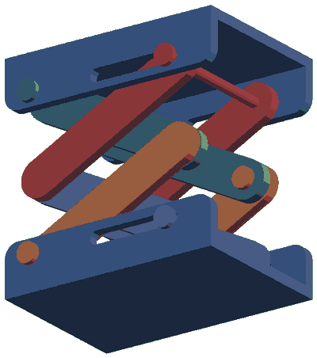
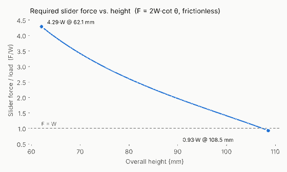
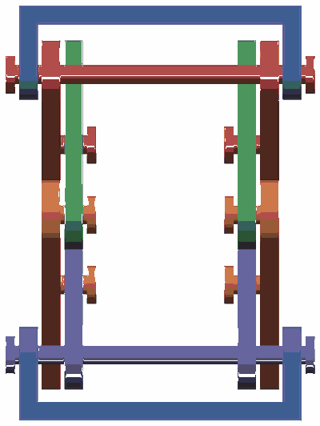

# Scissor Lift Mechanism

> Term project — **Machinery** course
> Kinematic & force analysis, symbolic modeling, Simscape Multibody simulation, and an SLS-printed prototype of a two-stage scissor lift.

<p align="center">
  
  
</p>

---

## Table of Contents
1. [Project Overview](#project-overview)
2. [Part I — Mechanism Basics](#part-i--mechanism-basics)
3. [Part II — Symbolic Analysis](#part-ii--symbolic-analysis)
4. [Part III — Simscape Multibody Simulation](#part-iii--simscape-multibody-simulation)
5. [Part IV — Built Prototype (SLS)](#part-iv--built-prototype-sls)
6. [How to Run](#how-to-run)
7. [Repository Structure](#repository-structure)
8. [Team](#team)

---

## Project Overview

| Item | Value |
|---|---|
| Mechanism type | Scissor lift, **2 stages** (X-linkage), planar 1-DOF |
| Function | Horizontal slider motion → vertical platform lift |
| Input | Slider pin moving in a slot (manual / actuator) |
| Arm length (pin-to-pin) `L` | **48 mm** |
| Arm angle range | **θ = 25° → 65°** (limited by slot length) |
| Overall height | **62.1 mm → 108.5 mm** (stroke 46.4 mm) |
| Footprint | 65 × 58 mm (incl. pin heads) |
| Parts | 17 bodies (see [Part list](#part-list)) |
| Manufacturing | SLS 3D printing (PA12 nylon) |
| CAD | [`hardware/mechanical/assembly/scissor_lift_assembly.stl`](hardware/mechanical/assembly/scissor_lift_assembly.stl) |

---

## Part I — Mechanism Basics

### 1.1 Kinematic Diagram & Link Identification
<p align="center"></p>

| # | Link | Role |
|---|---|---|
| 1 | Base (U-channel) | Ground; fixed pivot + slot |
| 2 | Lower arm A | Fixed pivot → upper stage joint |
| 3 | Lower arm B | Slider → upper stage joint |
| 4 | Upper arm A | Lower stage joint → platform slider |
| 5 | Upper arm B | Lower stage joint → platform fixed pivot |
| 6 | Platform (U-channel) | Output; fixed pivot + slot |

Each arm pair crosses at a center pivot (C1, C2). Left and right sides are identical, so the mechanism is analyzed as one planar linkage.

### 1.2 Degrees of Freedom (Grübler–Kutzbach)
Links `n = 6`, full joints `j1 = 6` (2 fixed pivots, 2 center pivots, 2 stage joints), half joints `j2 = 2` (pin-in-slot at base and platform):
```
DOF = 3(n − 1) − 2·j1 − j2
    = 3(6 − 1) − 2(6) − 2 = 1
```
→ one input (slider position) fully determines platform height.

### 1.3 Lift Range & Working Space
Geometry from the CAD model:

| Quantity | Value |
|---|---|
| Fixed pivot x | 8.0 mm |
| Slot (pin center travel) | x = 28.3 → 51.5 mm |
| Horizontal pin span `s = L cos θ` | 20.3 → 43.5 mm |
| Pin height per stage `L sin θ` | 20.3 → 43.5 mm |
| Offset below bottom pin / above top pin | 10.5 mm / 11.0 mm |

`H_total(θ) = 2·L·sin θ + 21.5 mm`

| Pose | θ | Overall height |
|---|---|---|
| Lowest | 25.0° | 62.1 mm |
| CAD model pose | 27.7° | 66.1 mm |
| Highest | 65.0° | 108.5 mm |

<p align="center"></p>

> Highest pose is the geometric limit set by the slot; arm interference near full extension should be checked on the prototype.

### 1.4 Mechanical Advantage & Critical Position
Virtual work with load `W` on the platform and horizontal slider force `F` (frictionless, link weight ignored):
```
H = 2 L sin θ ,  s = L cos θ   →   dH/ds = −2 cot θ
F = 2 W cot θ
```
- θ = 25° (lowest): **F = 4.29 W** ← critical design point
- θ = 65° (highest): **F = 0.93 W**

<p align="center"></p>

The same ratio is the velocity ratio: `v_platform = 2 cot θ · v_slider`.

---

## Part II — Symbolic Analysis
Files: [`simulation/symbolic/`](simulation/symbolic)

### 2.1 Position
`s = L cos θ`, `H = 2 L sin θ`

### 2.2 Velocity & Acceleration
`Ḣ = 2 L cos θ · θ̇`  ·  `Ḧ = 2 L (cos θ · θ̈ − sin θ · θ̇²)`

### 2.3 Force Analysis
`F = 2 W cot θ` (see 1.4)

### 2.4 Results Summary
| Quantity | Value | At θ = |
|---|---|---|
| Max slider force | 4.29 W | 25° |
| Min slider force | 0.93 W | 65° |
| Max velocity ratio `Ḣ/ṡ` | 4.29 | 25° |

---

## Part III — Simscape Multibody Simulation
Files: [`simulation/multibody/`](simulation/multibody)

1. Export CAD assembly → Simscape Multibody (`smimport`)
2. Drive the slider (prismatic joint) / apply load on platform
3. Compare with symbolic results

| Quantity | Symbolic | Simscape | Error (%) |
|---|---|---|---|
| Max height | 108.5 mm | | |
| Max slider force | 4.29 W | | |

---

## Part IV — Built Prototype (SLS)

<p align="center">
  
  
</p>

### Part list
| Qty | Part | Size (mm) | Volume each (cm³) |
|---|---|---|---|
| 1 | Platform (U-channel, slot + pivot holes) | 65 × 55 × 15 | 14.81 |
| 1 | Base (U-channel, slot + pivot holes) | 64 × 45 × 15 | 12.66 |
| 2 | Arm with integrated pin | 59 × 11 × 3 (+ pin) | 2.06 |
| 2 | Arm | 59 × 11 × 3 | 1.85 |
| 4 | Arm | 59 × 11 × 3 | 1.81 |
| 2 | Cross rod, Ø3 | 58 long | 0.47 |
| 1 | Cross rod (base slider), Ø3 | 48 long | 0.40 |
| 4 | Short pin | Ø6 × 7.6 | 0.09 |
| **17** | **Total** | envelope 65 × 58 × 66.1 | **44.19** |

Estimated mass in PA12 (≈ 0.95–1.0 g/cm³): **≈ 42–44 g**.
Bill of materials: [`hardware/bom.csv`](hardware/bom.csv)

### SLS printing notes
- Holes in base/platform walls are Ø3.24 mm for Ø3 rods (≈ 0.12 mm radial clearance).
- In the CAD file, arm-to-arm faces and pins-to-arm holes have **≈ 0 mm gap**. Printed as one assembly they will fuse — either print the 17 parts separately and assemble, or add clearance (typically ≥ 0.3–0.5 mm for SLS print-in-place; confirm with the print service).
- No supports needed (SLS); de-powder the slots and pin holes before assembly.

### Prototype results
- Measured height range vs. theoretical (62.1 → 108.5 mm):
- Problems found & improvements:

---

## How to Run
**Requirements:** MATLAB · Symbolic Math Toolbox · Simscape · Simscape Multibody

```matlab
>> RUN_ME
```
`RUN_ME.m` runs [`simulation/symbolic/scissor_kinematics.m`](simulation/symbolic/scissor_kinematics.m) (height & force curves) and opens the Simscape model.

---

## Repository Structure
```
Scissor-Lift-Mechanism/
├── README.md
├── RUN_ME.m                    # One-click runner
├── docs/                       # Report (PDF) & presentation slides
├── hardware/
│   ├── mechanical/
│   │   ├── parts/              # Individual part files
│   │   └── assembly/           # scissor_lift_assembly.stl
│   ├── drawings/               # 2D engineering drawings (PDF)
│   └── bom.csv                 # Bill of materials
├── simulation/
│   ├── symbolic/               # scissor_kinematics.m + output tables
│   └── multibody/              # Simscape model (.slx) + import script
├── data/                       # Raw results (.csv) — simulation & measurements
└── media/
    ├── diagrams/               # Kinematic diagram, CAD renders
    ├── plots/                  # Graphs from analysis
    ├── animation/              # GIF of motion
    └── prototype/              # Photos of the built mechanism
```

---

## Team
| Name | Student ID | Responsibility |
|---|---|---|
| | | CAD & prototype |
| | | Symbolic analysis |
| | | Simscape simulation |

**Course:** Machinery · **Instructor:** — · **Semester:** —
