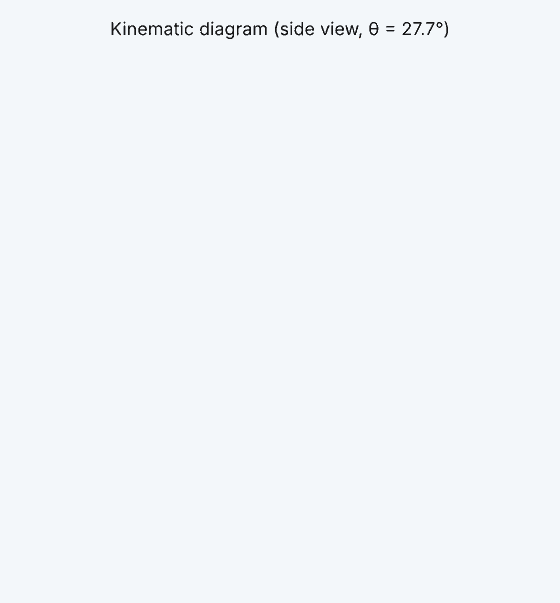
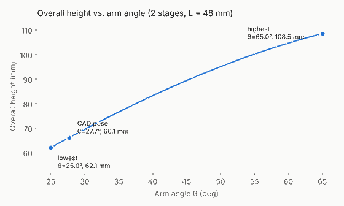
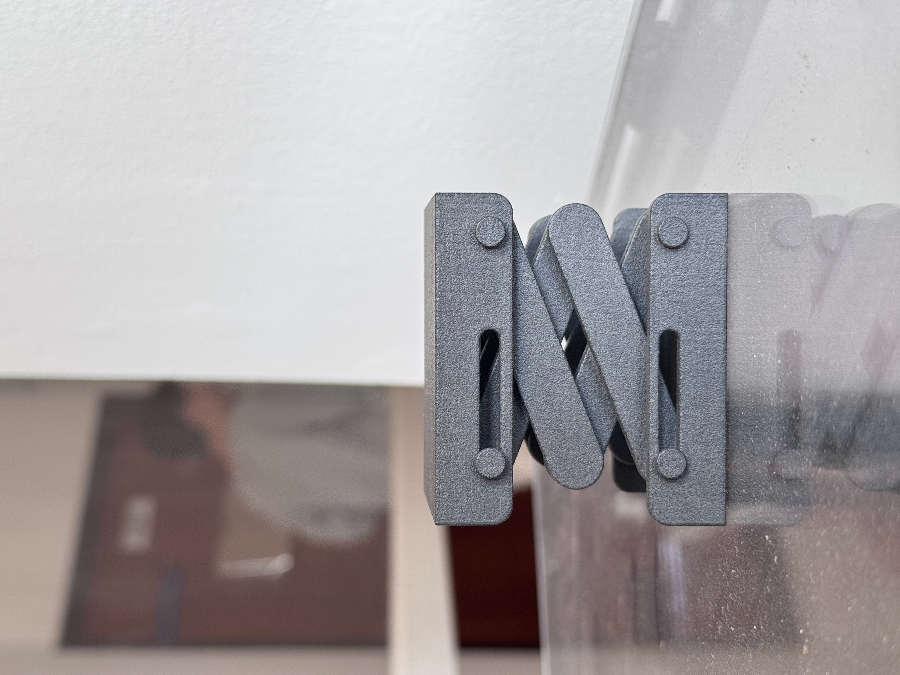
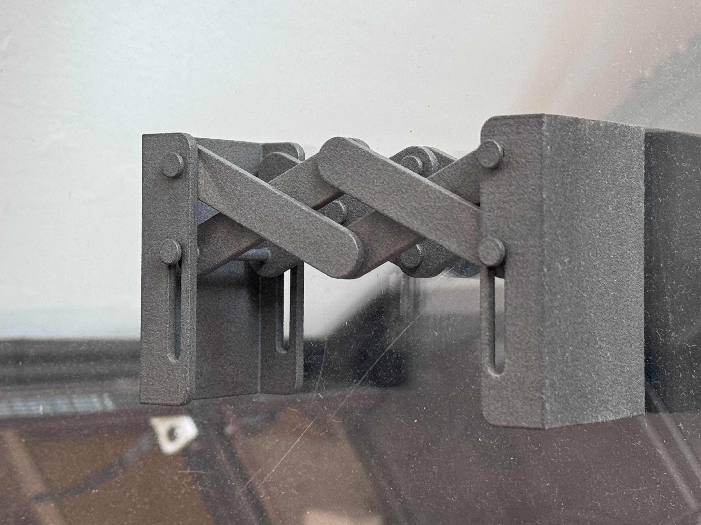
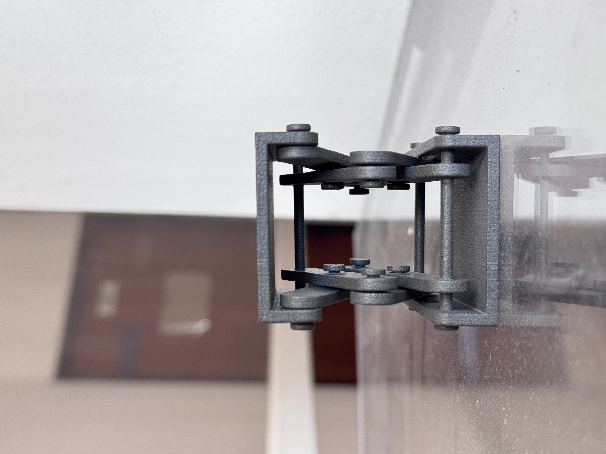

# Scissor Lift Mechanism

> Term project — **Machinery** course
> Kinematic & force analysis, symbolic modeling, Simscape Multibody simulation, and a print-in-place SLS prototype (Formlabs Fuse 1+ 30W) of a two-stage scissor lift.

<p align="center">
  
  
</p>

---

## Table of Contents
1. [Project Overview](#project-overview)
2. [Part I — Mechanism Basics](#part-i--mechanism-basics)
3. [Part II — Symbolic Analysis](#part-ii--symbolic-analysis)
4. [Part III — Simscape Multibody Simulation](#part-iii--simscape-multibody-simulation)
5. [Part IV — Built Prototype (SLS)](#part-iv--built-prototype-sls)
6. [How to Run](#how-to-run)
7. [Repository Structure](#repository-structure)
8. [Team](#team)

---

## Project Overview

| Item | Value |
|---|---|
| Mechanism type | Scissor lift, **2 stages** (X-linkage), planar 1-DOF |
| Function | Horizontal slider motion → vertical platform lift |
| Input | Slider pin moving in a slot (manual / actuator) |
| Arm length (pin-to-pin) `L` | **48 mm** |
| Arm angle range | **θ = 25° → 65°** (limited by slot length) |
| Overall height | **62.1 mm → 108.5 mm** (stroke 46.4 mm) |
| Footprint | 64 × 49.2 mm (incl. pin heads) |
| Parts | 7 printed parts, pins built in (see [Part list](#part-list)) |
| Manufacturing | SLS print-in-place, Formlabs Fuse 1+ 30W (nylon) |
| Design version | **v3** (see [Design revisions](#design-revisions)) |
| CAD | [`00_Assembly_ScissorLift_v3.step`](hardware/mechanical/assembly/00_Assembly_ScissorLift_v3.step) · [3D preview (STL)](hardware/mechanical/assembly/00_Assembly_ScissorLift_v3.stl) · [print file (.3mf)](hardware/mechanical/assembly/00_Assembly_PrintInPlace_Fuse1plus30W.3mf) |

---

## Part I — Mechanism Basics

### 1.1 Kinematic Diagram & Link Identification
<p align="center"></p>

| # | Link | Role |
|---|---|---|
| 1 | Base plate | Ground; fixed pivot + slot |
| 2 | Lower arm A | Fixed pivot → upper stage joint |
| 3 | Lower arm B | Slider → upper stage joint |
| 4 | Upper arm A | Lower stage joint → platform slider |
| 5 | Upper arm B | Lower stage joint → platform fixed pivot |
| 6 | Top plate | Output; fixed pivot + slot |

Each arm pair crosses at a center pivot (C1, C2). Left and right sides are identical, so the mechanism is analyzed as one planar linkage.

### 1.2 Degrees of Freedom (Grübler–Kutzbach)
Links `n = 6`, full joints `j1 = 6` (2 fixed pivots, 2 center pivots, 2 stage joints), half joints `j2 = 2` (pin-in-slot at base and platform):
```
DOF = 3(n − 1) − 2·j1 − j2
    = 3(6 − 1) − 2(6) − 2 = 1
```
→ one input (slider position) fully determines platform height.

### 1.3 Lift Range & Working Space
Geometry from the CAD model:

| Quantity | Value |
|---|---|
| Fixed pivot x | 8.0 mm |
| Pivot hole / slot width | Ø3.8 mm (for Ø3 pins) |
| Slot (pin center travel) | x = 28.3 → 51.5 mm |
| Horizontal pin span `s = L cos θ` | 20.3 → 43.5 mm |
| Pin height per stage `L sin θ` | 20.3 → 43.5 mm |
| Offset below bottom pin / above top pin | 10.5 mm / 11.0 mm |

`H_total(θ) = 2·L·sin θ + 21.5 mm`

| Pose | θ | Overall height |
|---|---|---|
| Lowest | 25.0° | 62.1 mm |
| CAD model pose | 27.7° | 66.1 mm |
| Highest | 65.0° | 108.5 mm |

<p align="center"></p>

> Full range 62–108 mm was checked in CAD with no collisions (v3); confirm on the printed prototype.

### 1.4 Mechanical Advantage & Critical Position
Virtual work with load `W` on the platform and horizontal slider force `F` (frictionless, link weight ignored):
```
H = 2 L sin θ ,  s = L cos θ   →   dH/ds = −2 cot θ
F = 2 W cot θ
```
- θ = 25° (lowest): **F = 4.29 W** ← critical design point
- θ = 65° (highest): **F = 0.93 W**

<p align="center"></p>

The same ratio is the velocity ratio: `v_platform = 2 cot θ · v_slider`.

---

## Part II — Symbolic Analysis
Files: [`simulation/symbolic/`](simulation/symbolic)

### 2.1 Position
`s = L cos θ`, `H = 2 L sin θ`

### 2.2 Velocity & Acceleration
`Ḣ = 2 L cos θ · θ̇`  ·  `Ḧ = 2 L (cos θ · θ̈ − sin θ · θ̇²)`

### 2.3 Force Analysis
`F = 2 W cot θ` (see 1.4)

### 2.4 Results Summary
| Quantity | Value | At θ = |
|---|---|---|
| Max slider force | 4.29 W | 25° |
| Min slider force | 0.93 W | 65° |
| Max velocity ratio `Ḣ/ṡ` | 4.29 | 25° |

---

## Part III — Simscape Multibody Simulation
Files: [`simulation/multibody/`](simulation/multibody)

1. Export CAD assembly → Simscape Multibody (`smimport`)
2. Drive the slider (prismatic joint) / apply load on platform
3. Compare with symbolic results

| Quantity | Symbolic | Simscape | Error (%) |
|---|---|---|---|
| Max height | 108.5 mm | | |
| Max slider force | 4.29 W | | |

---

## Part IV — Built Prototype (SLS)

<p align="center">
  
  
</p>

### Part list
All parts share one assembly coordinate system (mm) — open them together and they snap into place.

| # | Part | Includes | Size (mm) | Volume (cm³) |
|---|---|---|---|---|
| 01 | TopPlate | — | 64 × 45 × 15 | 12.54 |
| 02 | BasePlate | — | 64 × 45 × 15 | 12.54 |
| 03 | LowerArm_Left | 3 built-in pins | 53.5 × 14.4 × 33.3 | 2.09 |
| 04 | LowerArm_Right | 3 built-in pins | 53.5 × 14.4 × 33.3 | 2.09 |
| 05 | UpperArms_with_Pins_and_TopSlideRod | arm pair + center/lower pins + top slide rod | 53.5 × 49.2 × 33.3 | 4.40 |
| 06 | UpperLinks_with_TopPivotRod | link pair + top pivot rod | 53.5 × 49.2 × 33.3 | 3.97 |
| 07 | LowerLinks_with_BottomSlideRod | link pair + bottom slide rod | 53.5 × 49.2 × 33.3 | 3.97 |
| | **Total (7 parts)** | | envelope 64 × 49.2 × 66.1 | **41.59** |

Estimated mass in nylon (≈ 0.95–1.0 g/cm³): **≈ 40–42 g**.
Files: [`hardware/mechanical/parts/`](hardware/mechanical/parts) (STEP + STL per part) · BOM: [`hardware/bom.csv`](hardware/bom.csv)

### SLS print-in-place design (Fuse 1+ 30W)
| Feature | Value |
|---|---|
| Pins | Ø3 mm shaft, Ø6 mm head × 1.5 mm |
| Pivot holes & slots | Ø3.8 mm → **0.4 mm** clearance around pins |
| Mating faces (incl. pin head to wall) | **0.6 mm** gap |
| Smallest gap measured between any two parts | 0.40 mm |

- Print the whole mechanism in one job with [`00_Assembly_PrintInPlace_Fuse1plus30W.3mf`](hardware/mechanical/assembly/00_Assembly_PrintInPlace_Fuse1plus30W.3mf) (already centered on the build area); create the `.form` file in PreForm.
- Parts 05–07 have pins/rods fused to the arms so nothing falls out — they **cannot** be printed separately and assembled (pin heads are larger than the holes).
- Clear all powder from holes, slots and pin gaps before moving the mechanism.

### Design revisions
| Version | Change |
|---|---|
| v1 | 17 separate bodies, ≈ 0 mm gap at pins and arm faces → would fuse in a single SLS job |
| **v3** | 7 parts with built-in pins, 0.4 mm pin / 0.6 mm face clearance, print-in-place on Fuse 1+ 30W; kinematics unchanged (L = 48 mm, θ = 25°–65°) |

### Prototype results
<p align="center">
  
  
  
</p>
<p align="center"><em>Lowest position · Highest position · Side view</em></p>

- Measured height range vs. theoretical (62.1 → 108.5 mm):
- Problems found & improvements:

---

## How to Run
**Requirements:** MATLAB · Symbolic Math Toolbox · Simscape · Simscape Multibody

```matlab
>> RUN_ME
```
`RUN_ME.m` runs [`simulation/symbolic/scissor_kinematics.m`](simulation/symbolic/scissor_kinematics.m) (height & force curves) and opens the Simscape model.

---

## Repository Structure
```
Scissor-Lift-Mechanism/
├── README.md
├── RUN_ME.m                    # One-click runner
├── docs/                       # Report (PDF) & presentation slides
├── hardware/
│   ├── mechanical/
│   │   ├── parts/              # STEP/ + STL/ — 7 parts (01–07)
│   │   └── assembly/           # v3 assembly .step / .stl + print-in-place .3mf
│   ├── drawings/               # 2D engineering drawings (PDF)
│   └── bom.csv                 # Bill of materials
├── simulation/
│   ├── symbolic/               # scissor_kinematics.m + output tables
│   └── multibody/              # Simscape model (.slx) + import script
├── data/                       # Raw results (.csv) — simulation & measurements
└── media/
    ├── diagrams/               # Kinematic diagram, CAD renders
    ├── plots/                  # Graphs from analysis
    ├── animation/              # GIF of motion
    └── prototype/              # Photos of the built mechanism
```

---

## Team
| Name | Student ID | Responsibility |
|---|---|---|
| Benja Phatarachreonsophon | 6730277321 | CAD & prototype |
| Punyawee Chaiiam | 6730320621 | Symbolic analysis |
| Phasit Chaisrithong | 6730353321 | Simscape simulation |

